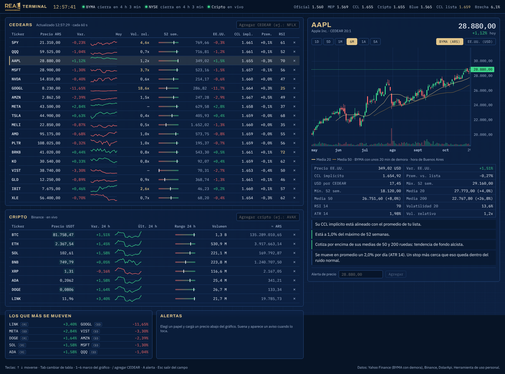

# RIC Terminal

Terminal personal de mercado al estilo Bloomberg para seguir **CEDEARs y cripto** con datos reales.



## Qué muestra

**CEDEARs** (se actualiza cada 60 s)
- Precio en pesos, variación del día y gráfico de la rueda.
- **CCL implícito** de cada CEDEAR (precio ARS × ratio ÷ precio en EE.UU.) y su **premio o descuento** contra la mediana de tu lista. Sirve para ver qué CEDEAR está caro o barato en dólares antes de comprar o vender.
- Volumen relativo: el de hoy contra el promedio de 20 ruedas, ajustado por la hora de la rueda.
- Posición en el rango de 52 semanas, precio y variación de la acción en EE.UU. y RSI 14.
- Aviso ⚠ cuando el CCL implícito se aleja más de un 15 % del resto, lo que casi siempre significa que cambió el ratio.

**Cripto** (en vivo, segundo a segundo, vía Binance)
- Precio, variación y rango de 24 h, volumen y equivalente en pesos al dólar cripto.

**Panel de detalle** del papel elegido
- Gráfico de velas con volumen y medias de 20 y 50 (1D, 5D, 1M, 6M, 1A, 5A). En CEDEARs se puede ver BYMA en pesos o la acción en EE.UU. en dólares.
- Medias de 20, 50 y 200, RSI, volatilidad, ATR y máximos y mínimos.
- **Lectura rápida**: frases que resumen el estado del papel (tendencia, volumen, cercanía a máximos, sobrecompra, cuánto se mueve por día). Describe, no recomienda.
- **Alertas de precio**: suenan y aparece un aviso (también como notificación del sistema si le das permiso) cuando el precio llega al valor cargado.

**Barra superior**: hora de Buenos Aires, estado de BYMA, NYSE y cripto, dólar oficial, MEP, CCL, cripto y blue, CCL de tu lista y brecha.

### Teclado
| Tecla | Acción |
|---|---|
| ↑ ↓ | Moverse por la tabla |
| Tab | Pasar de CEDEARs a cripto y viceversa |
| 1 a 6 | Marco del gráfico |
| / | Agregar un CEDEAR |
| A | Cargar una alerta |
| Esc | Salir del campo de texto |

Las columnas se ordenan con un clic en el encabezado. La lista, las alertas y el último papel elegido quedan guardados en el navegador.

## Cómo usarla en tu PC

Necesitás [Node.js](https://nodejs.org) 20 o más nuevo.

```bash
npm install
npm run build
npm start
```

Y abrís http://localhost:3000. Para desarrollo, `npm run dev`.

## Agregar papeles

- **CEDEAR**: escribí el ticker de BYMA (por ejemplo `NFLX`). Si no está en la tabla de ratios, agregalo con su ratio: `XYZ 4`. Con el mismo comando corregís un ratio que haya cambiado.
- **Cripto**: cualquier par contra USDT que exista en Binance (por ejemplo `AVAX`).

## Fuentes de datos

| Dato | Fuente | Demora |
|---|---|---|
| CEDEARs en BYMA | Yahoo Finance (`AAPL.BA`) | ~20 min |
| Acciones en EE.UU. | Yahoo Finance | casi nula en la rueda |
| Cripto | Binance (`data-api` y `data-stream.binance.vision`) | en vivo |
| Dólares | [DolarApi](https://dolarapi.com) | la de cada cotización |

Todas son gratuitas y no piden cuenta. Limitaciones conocidas:
- Yahoo no tiene el historial de algunos CEDEARs (por ejemplo META y VIST). Para esos, las medias, el RSI y la volatilidad salen de la acción en EE.UU. llevada a pesos, y la terminal lo avisa.
- El estado de las ruedas no contempla feriados.
- Los ratios de `lib/ratios.ts` son del listado de BYMA de septiembre de 2026. Los 18 de la lista por defecto se verificaron con precios reales el 29/10/2026.

## Estructura

```
app/api/cedears   precios de BYMA y EE.UU., CCL implícito e indicadores
app/api/history   velas de Yahoo para el gráfico
app/api/dolar     cotizaciones del dólar
components/       tablas, gráfico, panel de detalle, alertas
hooks/            sondeo, WebSocket de Binance, alertas, almacenamiento
lib/              indicadores, métricas, ratios, formato y lectura rápida
tests/            pruebas de los cálculos (npm test)
```

## Ideas para seguir

- Bonos y ADRs argentinos (AL30, GD30, GGAL) y su CCL.
- Calendario económico y noticias.
- Alertas por premio de CCL o por volumen.
- Avisos a Telegram cuando la PC no está abierta.

---
Herramienta de uso personal. La información es descriptiva y no constituye recomendación de inversión.
